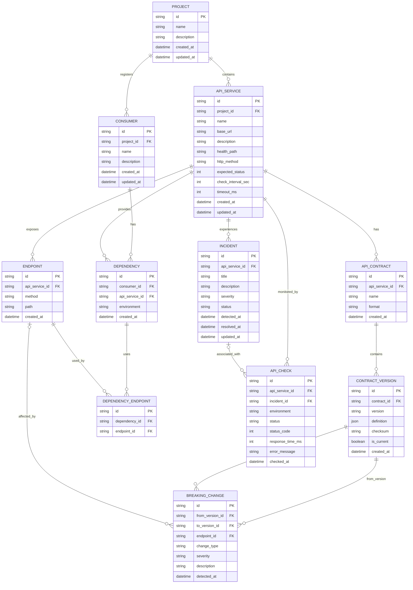

# API Sentinel - Entity Relationship Diagram (ERD)

## 1. Overview

API Sentinel is a platform designed to monitor API health, identify failures, track API contract changes, and understand dependencies between APIs and consuming applications.

This document describes the database structure for the API Sentinel MVP.

## 2. Database Entities

1. Project - Stores registered software projects.
2. ApiService - Stores APIs belonging to a project, including how each API is health-checked.
3. Consumer - Stores applications that consume APIs.
4. ApiContract - Stores API contract information.
5. ContractVersion - Stores different versions of API contracts.
6. Endpoint - Stores individual endpoints (method + path) exposed by an API.
7. Dependency - Connects consuming applications with APIs in a given environment.
8. DependencyEndpoint - Records which specific endpoints a dependency uses.
9. BreakingChange - Stores breaking changes detected between two contract versions.
10. ApiCheck - Stores API health-check results.
11. Incident - Stores detected API problems.

## 3. Entity Relationship Diagram



## 4. Relationship Explanations

| Relationship | Cardinality | Description |
|---|---|---|
| Project - API Service | One-to-Many | A project can contain multiple APIs. |
| Project - Consumer | One-to-Many | A project can register multiple consumers. |
| API Service - API Contract | One-to-Many | An API can have multiple contracts. |
| API Contract - Contract Version | One-to-Many | A contract can have multiple versions. |
| API Service - Endpoint | One-to-Many | An API exposes multiple endpoints. |
| Consumer - Dependency | One-to-Many | A consumer can depend on multiple APIs. |
| API Service - Dependency | One-to-Many | An API can have multiple consumers. |
| Dependency - Endpoint | Many-to-Many (via DependencyEndpoint) | A dependency can use several endpoints, and an endpoint can be used by several dependencies. |
| Contract Version - Breaking Change | One-to-Many (twice) | A breaking change links a `from` version and a `to` version. A version can appear on either side of many changes. |
| Endpoint - Breaking Change | One-to-Many (optional) | A breaking change may point to the endpoint it affects. Changes that are not endpoint-specific leave this empty. |
| API Service - API Check | One-to-Many | An API can have multiple health-check records. |
| API Service - Incident | One-to-Many | An API can have multiple incidents. |
| API Check - Incident | Many-to-One (optional) | An API check may optionally be associated with an incident. One incident may be associated with multiple checks. |

Consumer and ApiService are many-to-many through Dependency.

**Impact analysis path:** BreakingChange -> Endpoint -> DependencyEndpoint -> Dependency -> Consumer. This answers "which consumers are affected by this change?".

## 5. Database Constraints

Enforced by the Prisma schema (foreign keys and unique constraints):

- Every API service and every consumer must belong to an existing project.
- Every API contract must belong to an existing API service.
- Every contract version must belong to an existing contract.
- Every endpoint must belong to an existing API service.
- Every incident must belong to an existing API service.
- An API check may optionally reference an existing incident.
- A consumer cannot have duplicate dependencies on the same API in the same environment: unique (`consumer_id`, `api_service_id`, `environment`).
- Contract version labels must be unique within a contract: unique (`contract_id`, `version`).
- An endpoint (method + path) must be unique within an API service: unique (`api_service_id`, `method`, `path`).
- A dependency cannot list the same endpoint twice: unique (`dependency_id`, `endpoint_id`).

Enforced in application code or raw SQL (Prisma cannot express these):

- A dependency's consumer and API service must belong to the same project (unless cross-project dependencies are explicitly allowed later).
- A DependencyEndpoint's endpoint must belong to the same API service referenced by its Dependency. Without this, a consumer could be linked to an endpoint of an API it does not depend on, which would corrupt impact analysis.
- An API check's incident must belong to the same API service as the check.
- A breaking change's `from_version_id` and `to_version_id` must belong to the same contract, and its endpoint (if set) must belong to the same API service.
- An incident's `resolved_at` must be empty or not earlier than `detected_at`. In a migration:

```sql
ALTER TABLE "Incident"
  ADD CONSTRAINT incident_resolved_after_detected
  CHECK ("resolvedAt" IS NULL OR "resolvedAt" >= "detectedAt");
```

- A contract must have at most one current version. Prisma's `@@unique` cannot express this without also restricting historical versions, so use a PostgreSQL partial unique index in a custom migration:

```sql
CREATE UNIQUE INDEX contract_version_one_current
  ON "ContractVersion" ("contractId")
  WHERE "isCurrent" = true;
```

To add raw SQL like this and the CHECK constraint above, run `npx prisma migrate dev --create-only`, add the statements to the generated `migration.sql`, then apply it with `npx prisma migrate dev`.

Delete behavior:

- Deleting a project cascades to its APIs, consumers and everything beneath them.
- Deleting a dependency deletes its DependencyEndpoint records.
- Deleting an endpoint deletes its DependencyEndpoint records, so no orphaned join rows remain. Its breaking-change records are kept and their `endpoint_id` is set to null.
- Deleting an incident keeps its checks and sets their `incident_id` to null.

## 6. Scope and Assumptions

- PostgreSQL will be used as the database.
- Prisma ORM will manage database models and migrations.
- UUIDs will be used as primary keys.
- Foreign keys will maintain relationships between entities.
- Status-like fields (`severity`, `status`, `format`, `environment`, `change_type`, HTTP method) are Prisma enums.
- Timestamps use `timestamptz`.
- Contract definitions are stored as JSON (parsed OpenAPI documents). `checksum` is used to cheaply detect whether a spec changed, and `is_current` marks the latest version of a contract.
- Each ApiService represents one monitored base URL. `environment` on ApiCheck records which deployment was checked, defaulting to production.
- Nullable fields and why:
  - `ApiCheck.status_code` and `ApiCheck.response_time_ms` are empty when no response was received (for example, a timeout).
  - `ApiCheck.incident_id` is empty when a check is not part of any incident.
  - `BreakingChange.endpoint_id` is empty when a change is not tied to one specific endpoint.
  - `ApiCheck.error_message` is empty when a check succeeds.
  - `ContractVersion.checksum` and `Incident.resolved_at` are optional.
  - `description` is optional on Project, ApiService, Consumer and Incident. It is required on BreakingChange.
- ApiCheck will be the highest-volume table, so it is indexed on (`api_service_id`, `checked_at`).
- Mock data will be used during initial development.
- Human user authentication and authorization are outside the initial database scope.

## 7. Future Enhancements

The database can later be extended to support:

- User accounts and team management.
- Authentication for health checks against protected APIs.
- Separate base URLs per environment for one API.
- Notifications and alerts.
- Retention policies or partitioning for ApiCheck.
- Detailed API dependency analysis (for example, field-level usage).