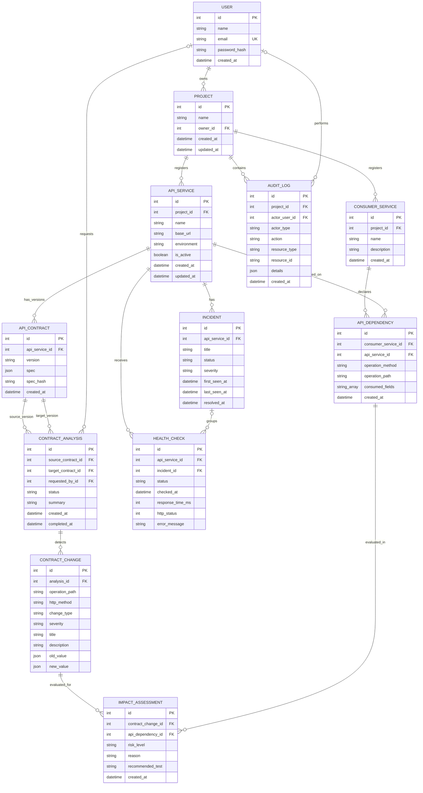

# API Sentinel — Entity Relationship Diagram (MVP)

## Mermaid ER diagram

GitHub renders the diagram below directly in Markdown. Keep this source version-controlled so the team can update the model alongside Prisma migrations.

## Entity responsibilities

| Entity | Purpose |
|---|---|
| `User` | Account that owns projects and may request analyses. |
| `Project` | Scopes registered APIs, consumer services, and audit activity. |
| `ApiService` | An API provider registered for contract management and health checks. |
| `ApiContract` | An immutable version of an API's OpenAPI specification. |
| `ConsumerService` | A dependent application/service registered by the team. |
| `ApiDependency` | Declares which API operation and fields a consumer uses. This is the key input for impact analysis. |
| `ContractAnalysis` | Records a comparison between a source contract and a target contract. |
| `ContractChange` | Stores each detected difference and its rule-based severity. |
| `ImpactAssessment` | Connects a detected change to a registered dependency and explains the potential risk. |
| `HealthCheck` | Stores one scheduled API check result, including latency and observed status. |
| `Incident` | Groups repeated health-check failures into a trackable incident. |
| `AuditLog` | Records significant actions for traceability, including user-initiated and MCP-mediated activity. |

## Important integrity rules

1. A contract version must be unique within an API service: `(apiServiceId, version)`.
2. A consumer dependency must be unique for the same consumer, provider, HTTP method, and path.
3. An impact assessment must be unique for a particular contract change and dependency pair.
4. The source and target contracts in an analysis must belong to the same API service, and the source and target must be different. Validate this in the service layer.
5. The consumer and provider in an API dependency must belong to the same project. Validate this in the service layer for the MVP.
6. A `HealthCheck` may belong to zero or one `Incident`; an incident may group many checks.
7. Store OpenAPI specifications and before/after values as PostgreSQL JSONB through Prisma's `Json` type. Never store plaintext API secrets in `baseUrl`, contract specs, or logs.
8. Treat impact results as *potential impact* unless confirmed by consumer test results. Missing dependency records must be reported as a coverage limitation.

## MVP versus stretch scope

**MVP:** `Project`, `ApiService`, `ApiContract`, `ConsumerService`, `ApiDependency`, `ContractAnalysis`, `ContractChange`, and `ImpactAssessment`.

**Supporting features:** `HealthCheck` and `Incident`.

**Security/traceability:** `User` and `AuditLog`.

Keep the first implementation small. The diagram is the target MVP data model, but create and migrate the core contract/dependency tables first, then add monitoring and audit records in separate commits.
